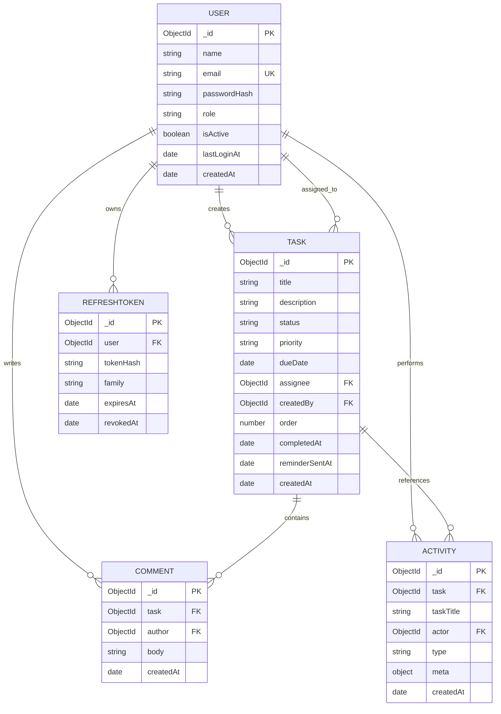

# Tasklane - Production Task Management System

Tasklane is an enterprise-grade, high-performance task management platform designed with an editorial, minimalist aesthetic. Built for modern software engineering and product teams, it provides a centralized workspace to create, prioritize, track, and analyze team velocity.

---

## Screenshots

> Screenshots can be captured and inserted below after local execution or production deployment.

- Landing Page Hero: `docs/screenshots/landing-hero.png`
- Dashboard Analytics: `docs/screenshots/dashboard-analytics.png`
- Kanban Board View: `docs/screenshots/kanban-board.png`
- Tasks Filter & Table: `docs/screenshots/tasks-table.png`
- Task Drawer & Activity: `docs/screenshots/task-drawer.png`
- Team Administration: `docs/screenshots/team-management.png`

---

## Live Deployments & Documentation

- Live Frontend Application: https://tasklane-client.vercel.app (or custom deployment domain)
- Live REST API Server: https://tasklane-api.onrender.com (or Render/Railway backend domain)
- Interactive OpenAPI / Swagger Docs: https://tasklane-api.onrender.com/api/docs
- Local OpenAPI Specification: `http://localhost:5000/api/docs`

---

## Tech Stack

### Frontend
- Framework: React 18 with TypeScript and Vite
- Styling: Tailwind CSS with custom OKLCH neutral tokens and Figtree + Geist Mono typography
- Animations: Framer Motion (respecting `prefers-reduced-motion`)
- Drag and Drop: `@dnd-kit/core`, `@dnd-kit/sortable`, `@dnd-kit/utilities`
- Charts: Recharts (restrained blue, teal, slate, amber, and red palette; zero purple/indigo)
- Form Validation: React Hook Form with Zod schema resolution
- Toast Notifications: Sonner
- Date Utilities: Date-fns

### Backend
- Runtime: Node.js (v20+ / v22) with Express.js
- Database: MongoDB Atlas with Mongoose ODM
- Authentication: JWT access token in-memory, rotating refresh token stored in `httpOnly` secure cookies
- Password Hashing: Bcrypt with salt cost factor 12
- Security & Middleware: Helmet, CORS, Express Rate Limit, Express Mongo Sanitize, HPP, Compression, Cookie Parser
- Scheduling: Node-cron (daily automated deadline reminder emails)
- Email Transport: Nodemailer (SMTP with graceful fallback when unconfigured)
- Documentation: Swagger UI Express with OpenAPI 3.0 specification

---

## Features

### Core Capabilities
- High-Performance Dashboard: Aggregated metric cards with count reveals, donut status breakdown, priority bar chart, and 7/14/30-day velocity timeline.
- Comprehensive Tasks Table: Server-side pagination (10/20/50), debounced title search (300ms), multi-select status and priority filters, assignee filtering, and overdue toggles. All filter states synchronize bidirectionally with URL search parameters.
- Interactive Kanban Board: Drag-and-drop task progression across To Do, In Progress, and Completed columns powered by `@dnd-kit` with optimistic updates, persistent column order indexing, and mobile fallback menus.
- Universal Task Drawer: Deep slide-over drawer supporting task creation, multi-field edits, date pickers, assignee selection, and deletion confirmation dialogs.
- Formula-Sanitized CSV Export: One-click export streaming the currently active filtered dataset with formula injection guards (escaping cells prefixed with `=`, `+`, `-`, `@`).
- Team Directory & Administration: Dedicated administrative view to inspect member workloads, update roles (User/Admin), and activate or deactivate accounts with self-demotion guards.
- Responsive Layout: Rigorously styled and tested across 360px, 768px, 1024px, and 1440px viewports.

### Bonus Implementations
- In-Drawer Discussion Threads: Real-time comments allowing team members to discuss tasks. Authors can delete their own comments; administrators can moderate any comment.
- Task Activity History: Automated audit log capturing task creation, field modifications, status transitions, reassignments, and deletion events.
- Global Audit Feed: Workspace-wide activity feed grouped chronologically with action-type filtering.
- Automated Deadline Reminders: Daily background cron job identifying tasks due within 24 hours or newly overdue, sending batched reminder emails with duplicate prevention via `reminderSentAt`.
- OpenAPI / Swagger UI: Interactive documentation available at `/api/docs` alongside a standalone Postman collection in `docs/tasklane-collection.json`.

---

## Architecture Overview & Folder Structure

```
SWAN_Assignment_2/
├── client/                     # Frontend (React + Vite + TypeScript)
│   ├── src/
│   │   ├── components/
│   │   │   ├── common/         # BarFieldVisualization, HeroVisual
│   │   │   ├── layout/         # AppShell (Sidebar, Top Bar, Drawer)
│   │   │   └── ui/             # Button, Input, Badge, Skeleton, EmptyState
│   │   ├── constants/          # App constants (PRODUCT_NAME = 'Tasklane')
│   │   ├── features/
│   │   │   ├── activity/       # Activity timeline feed
│   │   │   ├── auth/           # AuthContext, LoginPage, RegisterPage
│   │   │   ├── board/          # Kanban Board with @dnd-kit
│   │   │   ├── dashboard/      # Metrics, Recharts visualizers
│   │   │   ├── landing/        # Public landing page (Auralink design)
│   │   │   ├── profile/        # User profile & credentials management
│   │   │   ├── tasks/          # Tasks table view & TaskDrawer
│   │   │   └── team/           # Admin user management
│   │   ├── lib/                # Axios client, utils, zodResolver
│   │   ├── routes/             # ProtectedRoute, RoleRoute guards
│   │   ├── App.tsx             # Route definitions with React.lazy
│   │   ├── index.css           # Tokens, morphing pill styles, animations
│   │   └── main.tsx            # Entry point
│   ├── index.html
│   ├── tailwind.config.js
│   ├── tsconfig.json
│   └── vite.config.ts
├── server/                     # Backend (Node.js + Express.js)
│   ├── src/
│   │   ├── config/             # env.js (zod), db.js, cors.js, logger.js
│   │   ├── controllers/        # auth, task, user, comment, stats, activity
│   │   ├── docs/               # swagger.js (OpenAPI 3.0 specification)
│   │   ├── jobs/               # reminderJob.js (node-cron daily scheduler)
│   │   ├── middleware/         # authenticate, authorize, validate, rateLimit, errorHandler
│   │   ├── models/             # User, Task, Comment, Activity, RefreshToken
│   │   ├── routes/             # Express route declarations
│   │   ├── seed/               # seed.js (idempotent demo seeder)
│   │   ├── services/           # auth, task, stats, user, comment, email, activity
│   │   ├── utils/              # ApiError, asyncHandler, csv, dates
│   │   ├── validators/         # Zod schemas for all resources
│   │   ├── app.js              # Express app setup (security & routes)
│   │   └── server.js           # Server listen & graceful shutdown
│   ├── tests/                  # Jest + Supertest + mongodb-memory-server
│   │   ├── auth.test.js
│   │   ├── tasks.test.js
│   │   ├── rbac.test.js
│   │   └── stats.test.js
│   └── Dockerfile
├── docs/
│   ├── ARCHITECTURE.md         # In-depth architectural decision records
│   └── tasklane-collection.json# Postman / Bruno API collection
├── .github/workflows/ci.yml    # CI test and build workflow
├── docker-compose.yml          # Multi-container local orchestration
└── .gitignore
```

---

## Database Design

### Data Models & Relationships

1. **User:**
   - Fields: `name` (String, 2-60), `email` (String, unique, lowercase, indexed), `passwordHash` (String, select: false), `role` (`admin` | `user`, default: `user`), `isActive` (Boolean, default: true), `lastLoginAt` (Date), `timestamps`.
2. **Task:**
   - Fields: `title` (String, 3-120, text indexed), `description` (String, max 2000), `status` (`todo` | `in_progress` | `completed`), `priority` (`low` | `medium` | `high`), `dueDate` (Date, optional), `assignee` (ObjectId, ref: User, indexed), `createdBy` (ObjectId, ref: User, indexed), `completedAt` (Date), `order` (Number, for Kanban ordering), `reminderSentAt` (Date), `timestamps`.
   - Compound Indexes: `{ status: 1, dueDate: 1 }`, `{ assignee: 1, status: 1 }`, `{ createdBy: 1, status: 1 }`, `{ title: 'text' }`.
   - Virtuals: `isOverdue` (`dueDate < startOfToday && status !== 'completed'`).
3. **Comment:**
   - Fields: `task` (ObjectId, ref: Task, indexed), `author` (ObjectId, ref: User, indexed), `body` (String, 1-1000), `timestamps`.
4. **Activity:**
   - Fields: `task` (ObjectId, ref: Task, indexed, nullable), `taskTitle` (String, snapshot for retention), `actor` (ObjectId, ref: User, indexed), `type` (Enum of 8 event types), `meta` (Mixed object), `createdAt`.
5. **RefreshToken:**
   - Fields: `user` (ObjectId, ref: User, indexed), `tokenHash` (String, indexed), `family` (String, indexed), `expiresAt` (Date, TTL indexed for auto-deletion), `revokedAt` (Date), `userAgent` (String), `ip` (String), `timestamps`.

### Entity Relationship Diagram



---

## Setup Instructions

### Prerequisites
- Node.js version 20.x or 22.x
- npm version 10.x or higher
- MongoDB instance (MongoDB Atlas URI or local MongoDB container)

### 1. Clone & Environment Configuration

```bash
git clone <repository-url>
cd SWAN_Assignment_2
```

Configure backend environment variables:
```bash
cp server/.env.example server/.env
```
Edit `server/.env` with your MongoDB connection string and JWT secrets.

Configure frontend environment variables:
```bash
cp client/.env.example client/.env
```
Ensure `VITE_API_URL` points to `http://localhost:5000/api/v1`.

### 2. Install Dependencies

```bash
# Install backend dependencies
cd server
npm install

# Install frontend dependencies
cd ../client
npm install
```

### 3. Seed Database with Realistic Demo Data

Run the idempotent database seeder to populate demo users, realistic tasks, discussions, and audit logs:

```bash
cd ../server
npm run seed
```

### 4. Run Development Servers

Start the backend API server (runs on port 5000):
```bash
cd server
npm run dev
```

In a separate terminal, start the Vite frontend development server (runs on port 5173):
```bash
cd client
npm run dev
```

Open `http://localhost:5173` in your browser.

### 5. Run Test Suite

Run the full backend integration test suite (runs in-memory via `mongodb-memory-server` without touching production databases):

```bash
cd server
npm test
```

### 6. Docker Development Setup

Alternatively, launch the complete environment (MongoDB + Backend API) using Docker Compose:

```bash
docker compose up --build
```

---

## Environment Variables Table

### Server (`server/.env`)

| Variable | Required | Default | Description |
|---|---|---|---|
| `NODE_ENV` | Yes | `development` | Runtime environment (`development`, `production`, `test`) |
| `PORT` | No | `5000` | HTTP listening port |
| `MONGODB_URI` | Yes | &mdash; | MongoDB Atlas or local connection string |
| `JWT_ACCESS_SECRET` | Yes | &mdash; | Secret key for signing access tokens (min 32 chars) |
| `JWT_REFRESH_SECRET` | Yes | &mdash; | Secret key for signing refresh tokens (min 32 chars) |
| `ACCESS_TOKEN_TTL` | No | `15m` | Lifetime of in-memory access token |
| `REFRESH_TOKEN_TTL` | No | `7d` | Lifetime of secure refresh token cookie |
| `CLIENT_URL` | Yes | `http://localhost:5173` | Allowed CORS origin (comma-separated for multi-domain) |
| `COOKIE_DOMAIN` | No | &mdash; | Optional domain override for cross-subdomain cookies |
| `ENABLE_REMINDERS` | No | `false` | Enable daily node-cron deadline reminder job |
| `SMTP_HOST` | No | &mdash; | SMTP hostname for reminder dispatches |
| `SMTP_PORT` | No | `587` | SMTP port |
| `SMTP_USER` | No | &mdash; | SMTP username |
| `SMTP_PASS` | No | &mdash; | SMTP password |
| `EMAIL_FROM` | No | `Tasklane Notifications <noreply@tasklane.com>` | Sender address |
| `ALLOW_SEED` | No | `false` | Must be `true` to allow `npm run seed` in production |
| `SEED_ADMIN_PASSWORD` | No | `AdminPass123!` | Initial administrator password |
| `SEED_USER_PASSWORD` | No | `UserPass123!` | Initial team members password |

### Client (`client/.env`)

| Variable | Required | Default | Description |
|---|---|---|---|
| `VITE_API_URL` | Yes | `/api/v1` | Root endpoint of the Tasklane REST API |

---

## REST API Endpoints

All endpoints are prefixed with `/api/v1`.

| Method | Endpoint | Access | Purpose |
|---|---|---|---|
| `GET` | `/health` | Public | Liveness check and database connection status |
| `POST` | `/auth/register` | Public | Create new team member account (role `user`) |
| `POST` | `/auth/login` | Public | Authenticate user, set refresh cookie, return access token |
| `POST` | `/auth/refresh` | Cookie | Rotate refresh token and return new access token |
| `POST` | `/auth/logout` | Auth | Revoke refresh token and clear cookie |
| `GET` | `/auth/me` | Auth | Retrieve current authenticated user profile |
| `PATCH` | `/auth/me` | Auth | Update user display name |
| `PATCH` | `/auth/me/password` | Auth | Change password (invalidates existing sessions) |
| `GET` | `/tasks` | Auth | List tasks with search, status/priority filter, sort, pagination |
| `POST` | `/tasks` | Auth | Create a new task (assign to any active member) |
| `GET` | `/tasks/:id` | Auth | Retrieve task details (returns 404 if unauthorized) |
| `PATCH` | `/tasks/:id` | Auth | Update task details (Admin or task creator) |
| `PATCH` | `/tasks/:id/status` | Auth | Update task status & Kanban order (Admin, creator, or assignee) |
| `DELETE` | `/tasks/:id` | Auth | Delete task and associated comments (Admin or task creator) |
| `GET` | `/tasks/export/csv` | Auth | Stream filtered task records as CSV download |
| `GET` | `/tasks/:id/comments` | Auth | List comments for accessible task |
| `POST` | `/tasks/:id/comments` | Auth | Post a comment to task discussion |
| `DELETE` | `/comments/:id` | Auth | Delete comment (Author or Admin) |
| `GET` | `/tasks/:id/activity` | Auth | Retrieve activity history for specific task |
| `GET` | `/activity` | Auth | Global activity feed (scoped by user role) |
| `GET` | `/stats/overview` | Auth | Dashboard metrics, status/priority counts, upcoming deadlines |
| `GET` | `/users/members` | Auth | Minimal member list for assignee selector dropdowns |
| `GET` | `/users` | Admin | Full member list with task metrics (Admin only) |
| `PATCH` | `/users/:id` | Admin | Update user role or active status (Admin only) |
| `GET` | `/api/docs` | Public | Interactive OpenAPI 3.0 Swagger UI documentation |

---

## Authentication & RBAC Explanation

- **Token Strategy:** The client holds the short-lived JWT access token in memory. It is attached via the `Authorization: Bearer <token>` header on every request. The long-lived refresh token is stored exclusively in an `httpOnly`, `SameSite=Lax` cookie. An Axios response interceptor silently catches 401 responses and exchanges the cookie for a fresh token pair without interrupting the user.
- **Reuse Detection:** Every refresh operation rotates the token record and marks the prior token revoked. If an already-revoked token is received, the system revokes the entire token family to defend against session hijacking.
- **RBAC Placement:** Authorization is strictly enforced on the server for every endpoint. Regular users are constrained to tasks they created or are assigned to (`{ $or: [{ createdBy: user._id }, { assignee: user._id }] }`). Any attempt by a standard user to view or edit an unauthorized task returns a `404 Not Found` rather than `403` to prevent leaking the existence of other records.
- **Admin Safeguards:** Administrators cannot demote or deactivate themselves. Furthermore, the last remaining active administrator cannot be demoted, guaranteeing that the workspace cannot become orphaned.

---

## Security Measures

1. **Password Protection:** Passwords are hashed using `bcrypt` with cost factor 12. The `passwordHash` field is marked `select: false` in Mongoose to prevent accidental exposure in queries.
2. **Timing-Safe Auth & Generic Errors:** Login failures return generic messages (`Invalid email or password`) to mitigate user enumeration.
3. **NoSQL Injection Defense:** `express-mongo-sanitize` strips dollar signs and dots from all request payloads.
4. **Parameter Pollution Defense:** `hpp` protects query strings from HTTP parameter pollution attacks.
5. **Security Headers:** `helmet` sets HTTP response security headers including Content-Security-Policy and X-Frame-Options.
6. **Rate Limiting:** `express-rate-limit` enforces strict limits on `/auth/login` and `/auth/register` (20 attempts per 15 minutes) alongside general API thresholds.
7. **CSV Injection Prevention:** Formula sanitization prefixes cells starting with `=`, `+`, `-`, `@`, `\t`, or `\r` with a single quote before generating CSV outputs.

---

## Production Deployment Guide

### Database (MongoDB Atlas)
1. Create a free M0 cluster on MongoDB Atlas.
2. Under Network Access, allow access from `0.0.0.0/0` (or your cloud egress IPs).
3. Under Database Access, create a dedicated application user with read/write privileges.
4. Copy the connection string to `MONGODB_URI`.

### Backend (Render or Railway)
1. Deploy as a Web Service from the GitHub repository using the `server` root directory.
2. Configure build command `npm install` and start command `npm start`.
3. Set the required environment variables in the dashboard:
   - `NODE_ENV=production`
   - `MONGODB_URI`
   - `JWT_ACCESS_SECRET`
   - `JWT_REFRESH_SECRET`
   - `CLIENT_URL` (your Vercel frontend URL)
   - `ENABLE_REMINDERS=true` (optional)
4. Verify health at `https://<your-backend-domain>/api/v1/health`.

### Frontend (Vercel)
1. Import the repository into Vercel and select the `client` directory as the project root.
2. Framework preset: Vite.
3. Set environment variable: `VITE_API_URL=https://<your-backend-domain>/api/v1`.
4. The included `client/vercel.json` ensures SPA route rewrites operate correctly for all deep links.

---

## Demo Credentials

The seeded database contains the following accounts:

| Role | Name | Email | Password |
|---|---|---|---|
| **Admin** | Eleanor Vance | `admin@tasklane.demo` | `AdminPass123!` |
| **User** | Maya Lin | `maya@tasklane.demo` | `UserPass123!` |
| **User** | Liam Chen | `liam@tasklane.demo` | `UserPass123!` |
| **User** | Ana Silva | `ana@tasklane.demo` | `UserPass123!` |

> Quick-fill buttons are also available directly on the login screen (`/login`) for instantaneous demo access.

---

## Known Limitations & Future Improvements

1. **Email SMTP Setup:** Reminder jobs require valid external SMTP credentials (`SMTP_HOST`, `SMTP_USER`, `SMTP_PASS`) to dispatch actual emails; when unconfigured, reminder events log simulated dispatches gracefully without crashing.
2. **WebSocket Live Sync:** Sprints currently update via optimistic UI updates and data reload signals. Adding WebSocket/SSE streaming would enable real-time multiplayer cursor and board card movement across multiple concurrent windows.
3. **Subtasks & Dependencies:** Tasks currently support descriptions, priorities, due dates, and discussion comments. Future iterations can introduce hierarchical subtask checklists and predecessor blockers.
